# SIEM Honeypot Lab with Azure and Microsoft Sentinel

## Overview

In this lab I deployed a Windows virtual machine in Azure as a honeypot, collected failed logon events, added IP geolocation data with a PowerShell script, and sent the results to a Log Analytics workspace. I then used KQL to extract the fields and create a world map of the activity.

The aim was to practise how security data moves from an endpoint into a central workspace, and how that data can be used for investigation and visualisation.

| Component | Used in this lab |
|---|---|
| Cloud platform | Microsoft Azure |
| Resource group | `honeypot-vm_group` |
| Target virtual machine | `honeypot-vm` |
| Workspace | `honeypot-law` |
| SIEM | Microsoft Sentinel enabled on the workspace |
| Log collection | Azure Monitor Agent (AMA) |
| Data collection rule | `honeypot-dcr` |
| Data collection endpoint | `honeypot-dce` |
| Custom table | `FAILED_RDP_WITH_GEO_CL` |
| Local log file | `C:\ProgramData\failed_rdp.log` |
| Enrichment | PowerShell exporter and the ipgeolocation.io API |
| Visualisation | Azure Workbook with a map |

> The honeypot was an isolated lab resource with no production data or reused credentials. Exposing RDP and relaxing the guest firewall were deliberate parts of this experiment, not a configuration for a normal server. Azure resources and log ingestion can incur charges, so the cleanup steps are part of the lab.

The screenshots record the portal interface used in May 2026. Some menus can differ in newer portal versions. Private account details and personal addresses have been cropped or redacted in the published copies.

## Contents

- [Preparing the Azure Resources](#preparing-the-azure-resources)
- [Reviewing Defender for Cloud](#reviewing-defender-for-cloud)
- [Enabling Microsoft Sentinel](#enabling-microsoft-sentinel)
- [Testing Network Connectivity](#testing-network-connectivity)
- [Collecting and Enriching Failed Logons](#collecting-and-enriching-failed-logons)
- [Configuring Azure Log Collection](#configuring-azure-log-collection)
- [Checking the Data Pipeline](#checking-the-data-pipeline)
- [Extracting Fields with KQL](#extracting-fields-with-kql)
- [Creating the Attack Map](#creating-the-attack-map)
- [Results and What I Learned](#results-and-what-i-learned)
- [Cleaning Up the Lab](#cleaning-up-the-lab)

## Preparing the Azure Resources

First sign in to the [Azure portal](https://portal.azure.com/) with an active subscription. I kept the main lab resources in `honeypot-vm_group` so they could be managed and removed together.

Create a Windows virtual machine called `honeypot-vm`, using a dedicated administrator account and password. The experiment needs a public endpoint for the RDP activity being observed. Keep administrative access restricted to your own address during setup, and only expose the honeypot for the observation period.

Azure network security group rules and Windows Firewall are separate controls. RDP uses TCP port 3389 by default; changing the Windows Firewall alone does not configure the Azure network rules. The exact VM size, Windows image, and NSG rule set are not recorded in the supplied screenshots.

Next create a **Log Analytics workspace** called `honeypot-law`. I used **East US** and the same resource group for this lab.

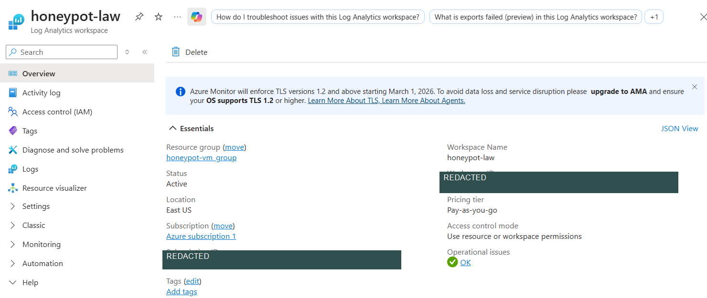

The workspace stores the collected logs. Creating it does not automatically connect the VM or start collecting the custom text file. That connection is configured later with AMA and a data collection rule.

## Reviewing Defender for Cloud

In the Azure portal, open **Microsoft Defender for Cloud > Environment settings**, select the workspace, and review **Defender plans**.

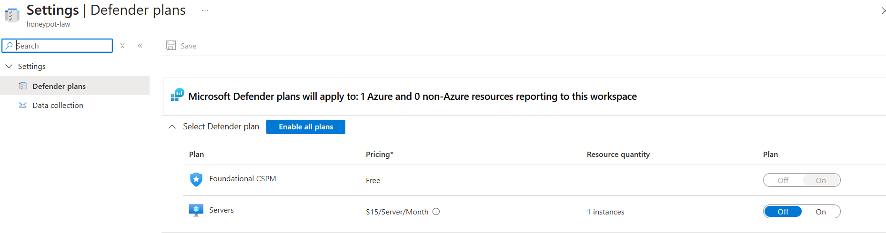

The screenshot shows **Foundational CSPM on** and **Servers off**. I have kept the documentation consistent with that screenshot. Defender for Servers is a separate plan and is not required for the custom text-log pipeline described here. The price visible in the screenshot is historical, so check the current plan details before enabling a paid option.

## Enabling Microsoft Sentinel

Next search for **Microsoft Sentinel** and click **Create**. Select the lab subscription and the `honeypot-law` workspace in `honeypot-vm_group`, then complete the creation flow.

Once it finishes, the workspace should appear in the Sentinel list.

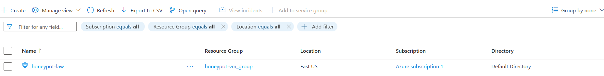

This enables Sentinel on the workspace. The custom table and workbook in the following steps demonstrate collection, querying, and visualisation. This lab does not include a configured analytics rule, generated incident, or automated response playbook.

## Testing Network Connectivity

Before changing the guest firewall, I tried pinging the VM from my own computer. All three requests timed out.


Inside the VM, I opened `wf.msc` and changed the firewall profile settings for the experiment. The screenshot below shows **Public Profile > Firewall state: Off** before clicking **Apply**.

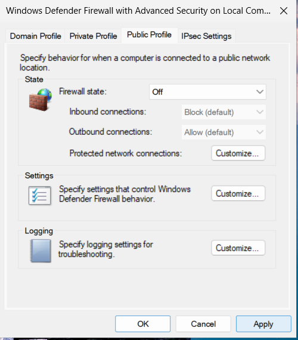

After applying the lab firewall changes, I repeated the ping test and received replies with **0% packet loss**.

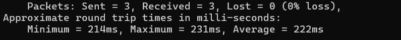

This confirmed that ICMP traffic could reach the VM. Ping does not prove that RDP authentication works, and allowing ping is not required to collect Windows logon events. A normal deployment should keep the firewall enabled and allow only the traffic it needs.

## Collecting and Enriching Failed Logons

### Checking the Windows Events

On the VM, open **Event Viewer > Windows Logs > Security** and look for **Event ID 4625**. The event records a failed logon and includes details that can help investigate the attempt.

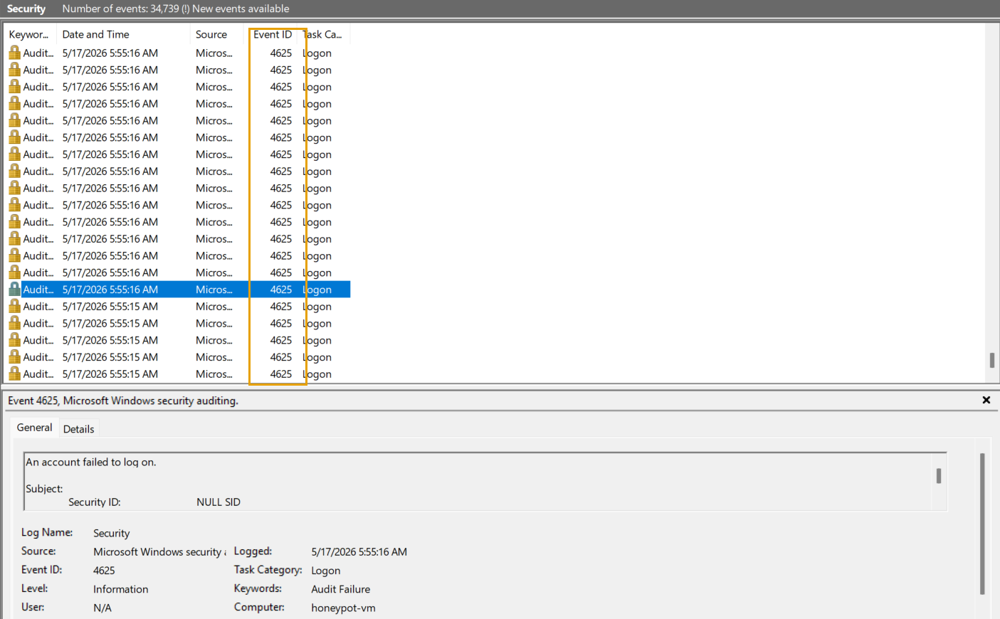

The selected event shows **An account failed to log on**. Event 4625 can also be generated by logon methods other than RDP. To classify an individual event as RDP-related, check its logon type, authentication details, source address, and surrounding activity rather than relying on the event ID alone.

### Running the PowerShell Exporter

I used a PowerShell script named `export-logs.ps1` to read failed logon events, extract the source address and attempted username, request geolocation data from **ipgeolocation.io**, and append the enriched records to:

```text
C:\ProgramData\failed_rdp.log
```

The script writes fields such as latitude, longitude, destination host, username, source host, state, country, label, and timestamp.

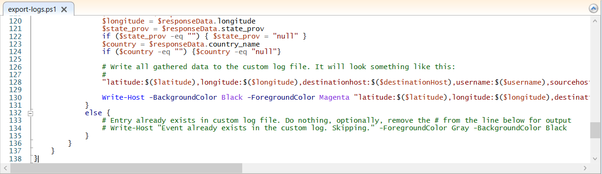

The original exporter source file was not included with the supplied lab files, so this repository documents its observed behaviour without presenting a reconstructed script as the original. Keep any API key outside published code and screenshots, and use a key belonging to your own account when reproducing the enrichment step.

When I first tried to run the script, PowerShell blocked it because script execution was disabled.

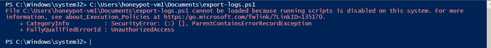

After reviewing the script, I set the execution policy for the current user and ran it again:

```powershell
Set-ExecutionPolicy RemoteSigned -Scope CurrentUser
```

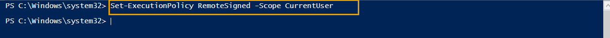

This changes the execution policy for that user. It does not make an untrusted script safe, and organisation policies can take precedence over it.

The exporter then began processing events and printing enriched records in the console. The example below shows attempted usernames and source addresses associated with the honeypot.

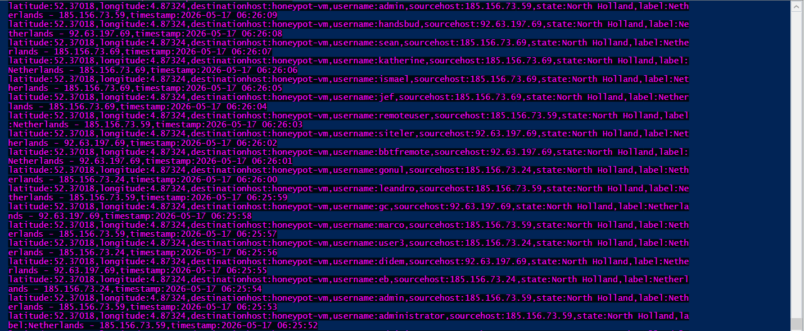

Next I checked that `failed_rdp.log` existed in **ProgramData** and contained records.

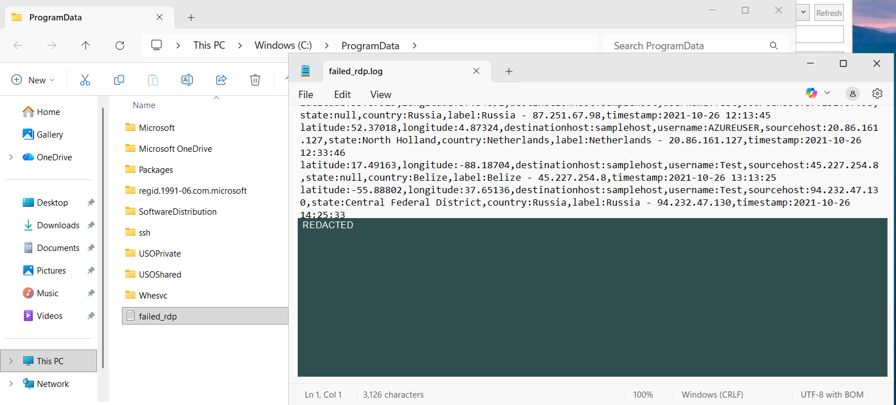

Some entries use `destinationhost:samplehost`. These are seeded examples used during setup, so the investigation query filters them out. A sample record in the file is not evidence of a real attempt against this VM.

## Configuring Azure Log Collection

### Creating the Data Collection Endpoint

Search for **Data collection endpoints** and click **Create**. I used:

| Setting | Value |
|---|---|
| Endpoint name | `honeypot-dce` |
| Resource group | `honeypot-vm_group` |
| Region | `East US` |

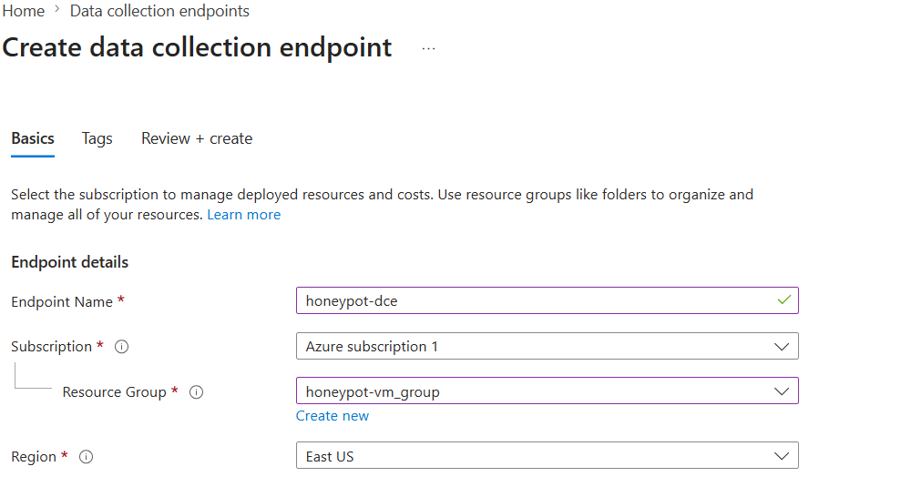

Click **Review + create**, then **Create**. Once deployment finishes, the endpoint appears in the list.

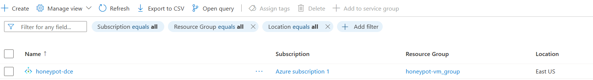

### Preparing the Data Collection Rule and Agent

Open **Monitor > Data collection rules** and create `honeypot-dcr` for the Windows VM. Use the lab resource group and region, and add `honeypot-vm` under **Resources** while the VM is running.

Enable the VM's system-assigned managed identity and install the **Azure Monitor Agent** through the supported DCR or VM extension workflow. Check **VM > Extensions + applications** for `AzureMonitorWindowsAgent`. The agent collects the local file according to the DCR; the DCR itself does not run inside the VM.

The screenshots show the resulting configuration and later heartbeat data. They do not capture every screen of the agent installation wizard.

### Creating the Custom Table

Next open **Log Analytics workspaces > honeypot-law > Settings > Tables** and click **Create** to add a custom log table.

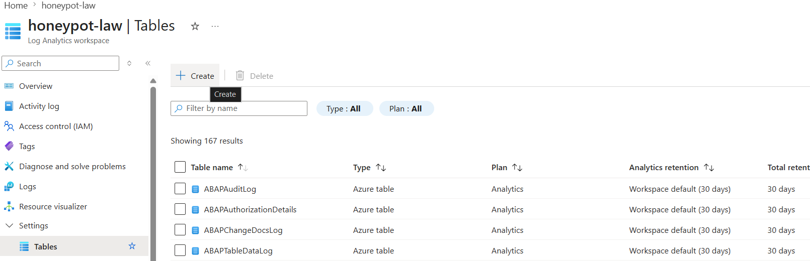

Enter `FAILED_RDP_WITH_GEO` as the table name. Azure adds the `_CL` suffix, giving the full name `FAILED_RDP_WITH_GEO_CL`. Select **Analytics**, `honeypot-dcr`, and `honeypot-dce`, as shown below.

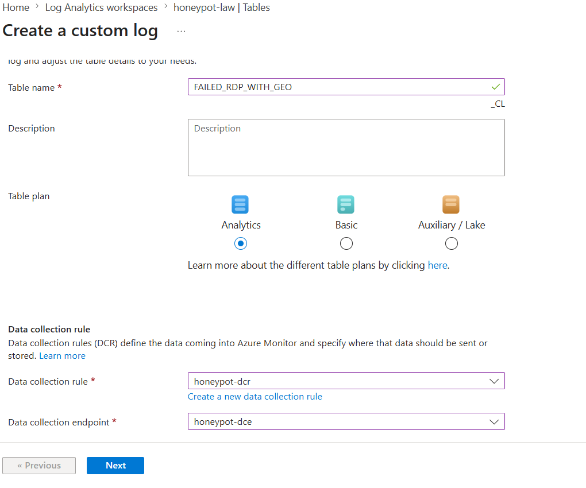

For the schema sample, create a JSON file in Notepad. The example below uses a documentation-only IP address and a `samplehost` destination:

```json
[
  {
    "TimeGenerated": "2026-05-17T12:00:00Z",
    "RawData": "latitude:47.91542,longitude:-120.60306,destinationhost:samplehost,username:fakeuser,sourcehost:192.0.2.1,state:Washington,country:United States,label:United States - 192.0.2.1,timestamp:2026-05-17 12:00:00"
  }
]
```

Select **File > Save As**, set **Save as type** to **All Files**, and save it as `sample.json` using UTF-8 encoding. Upload it in the table wizard.

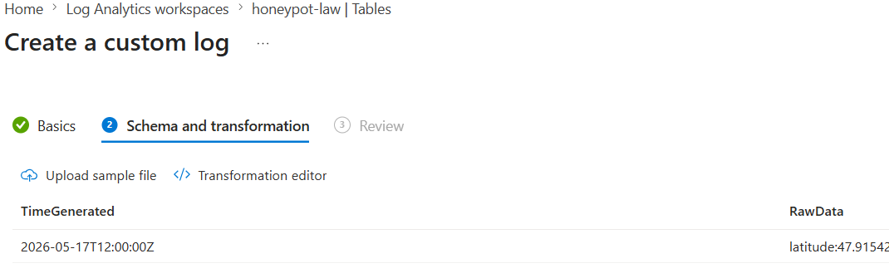

Check that `TimeGenerated` is a datetime and `RawData` is a string, then complete the review and creation steps. The upload defines the schema; it does not establish a live connection to the VM's file.

### Adding the Custom Text Log Source

Now open **Data collection rules > honeypot-dcr > Configuration > Data sources** and click **Add**.

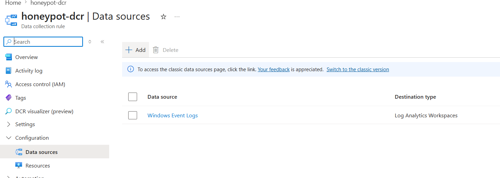

The screenshot shows an existing **Windows Event Logs** source before adding the custom file source. Windows event collection and collection of the enriched text file are separate inputs.

Configure the custom source with the following values:

| Setting | Value |
|---|---|
| Data source type | Custom Text Logs |
| File pattern | `C:\ProgramData\failed_rdp.log` |
| Table name | `FAILED_RDP_WITH_GEO_CL` |
| Transform | `source` |
| Record boundaries | One complete log record per line |

My setup notes used an **End of line** delimiter. Newer configuration screens may only offer **TimeStamp** with a timestamp format. Microsoft documents end-of-line fallback when no matching timestamp is found. Check the available options and verify that each line is ingested as one record.

On **Destination**, add the `honeypot-law` Log Analytics workspace, then save the data source.

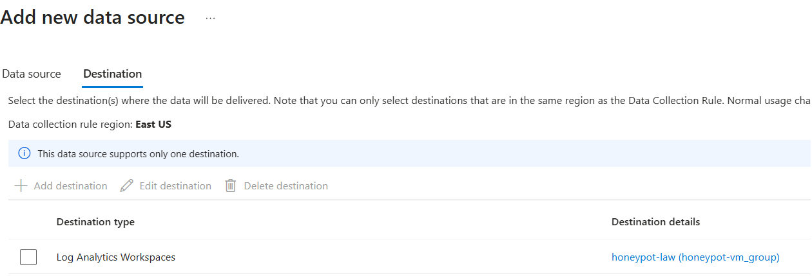

The file must be on the agent machine, use a supported text encoding such as UTF-8, and receive new entries by appending them. Keep the file path, destination table, and DCR association consistent.

## Checking the Data Pipeline

### Checking the Agent Heartbeat

Open **honeypot-law > Logs**, switch to **KQL mode**, and run:

```kusto
Heartbeat
| where Computer == "honeypot-vm"
| order by TimeGenerated desc
| take 5
```

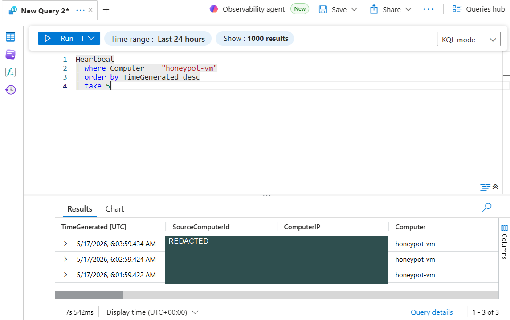

The returned rows confirm that an agent is reporting to this workspace. This is useful, but it does not prove that the custom file source is configured correctly. Check that separately.

If no heartbeat appears, first check the workspace and time range, the VM's running state, managed identity, AMA extension status, DCR association, and outbound connectivity. In my troubleshooting notes, the VM had been associated while deallocated. Removing and re-adding the association after starting it was one step to try, followed by allowing time for the configuration to apply. An empty query can have other causes too.

### Checking the Custom Table

Next run:

```kusto
FAILED_RDP_WITH_GEO_CL
| count
```

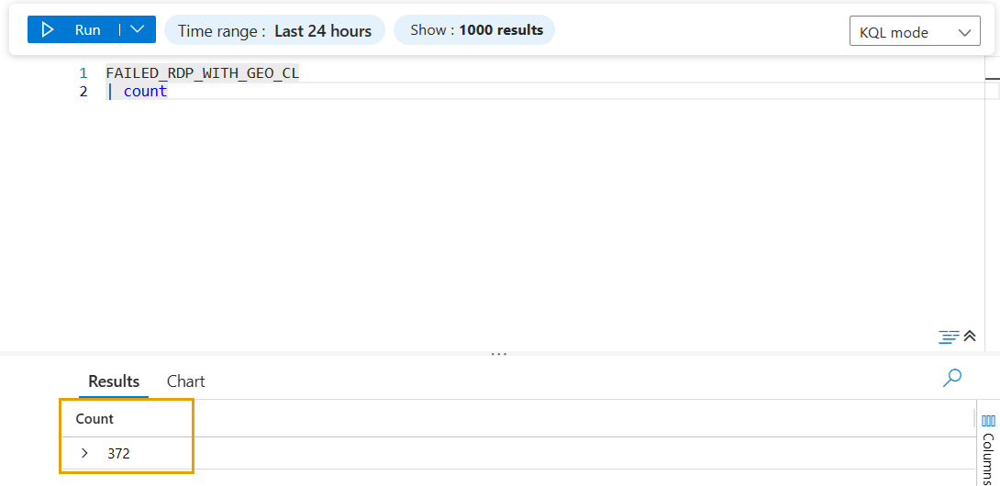

At the time of this screenshot, the query returned **372 records** in the selected time range. That confirms the table contained data, including any seeded samples that had been collected. It is not a count of confirmed unique attackers.

If the table stays empty, check that the exporter is appending new lines, the DCR file pattern matches the real file, the VM is associated with the rule, and the destination and schema are correct.

## Extracting Fields with KQL

The enriched records arrive in the `RawData` column. To make them easier to investigate, I extracted each field and filtered out the seeded examples:

```kusto
FAILED_RDP_WITH_GEO_CL
| extend username = extract(@"username:([^,]+)", 1, RawData),
         timestamp = extract(@"timestamp:([^,]+)", 1, RawData),
         latitude = extract(@"latitude:([^,]+)", 1, RawData),
         longitude = extract(@"longitude:([^,]+)", 1, RawData),
         sourcehost = extract(@"sourcehost:([^,]+)", 1, RawData),
         state = extract(@"state:([^,]+)", 1, RawData),
         label = extract(@"label:([^,]+)", 1, RawData),
         destination = extract(@"destinationhost:([^,]+)", 1, RawData),
         country = extract(@"country:([^,]+)", 1, RawData)
| where destination != "samplehost"
| where sourcehost != ""
| summarize event_count = count() by timestamp, label, country, state,
    sourcehost, username, destination, longitude, latitude
```

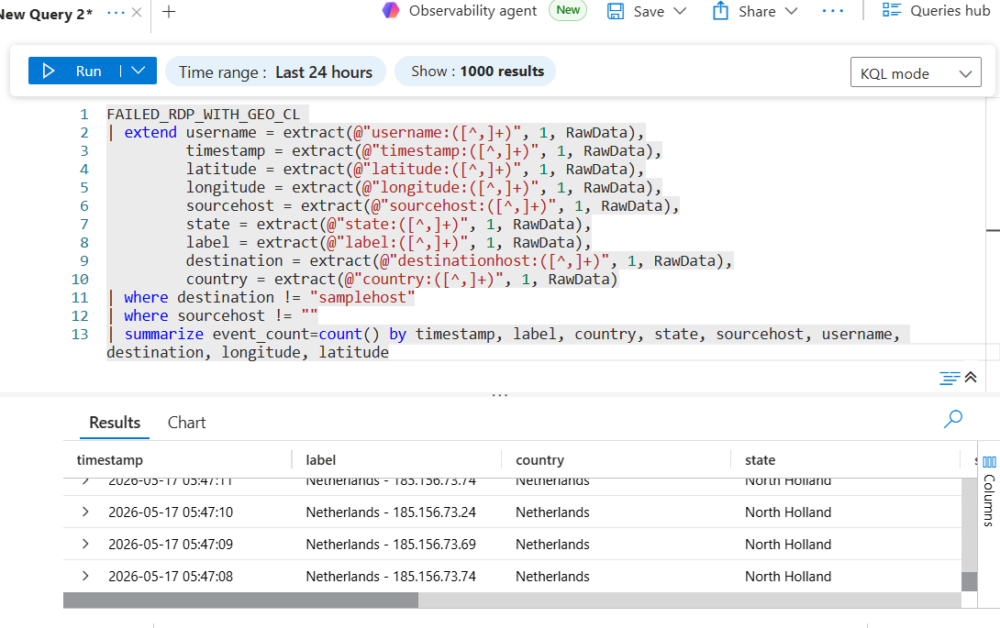

This is the query used in the captured results. It keeps the event timestamp and attempted username in the grouping, which is useful when inspecting individual activity. It also avoids the trailing comma that was left in one version of my draft.

The workspace time picker filters `TimeGenerated`. The extracted `timestamp` is a separate value from the exporter, so its timezone and format need to be checked before comparing it with other sources.

## Creating the Attack Map

### Adding a Workbook Query

I opened **Microsoft Defender for Cloud > General > Workbooks** and clicked **New**. This is the Azure Workbook gallery shown in the original lab, rather than a Sentinel analytics-rule page.

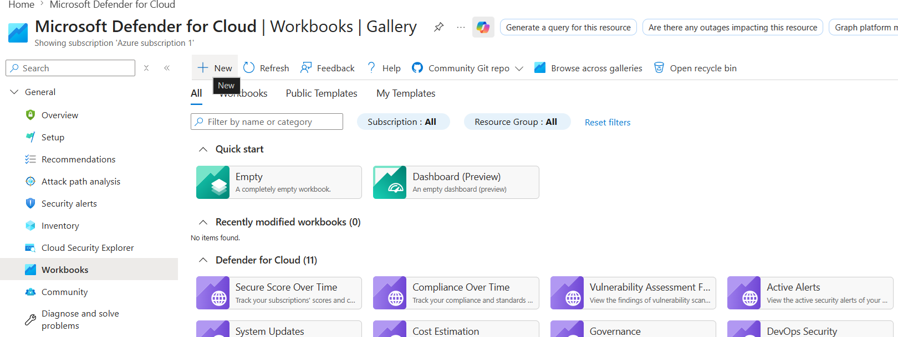

In the empty workbook, click **Add > Add query**.

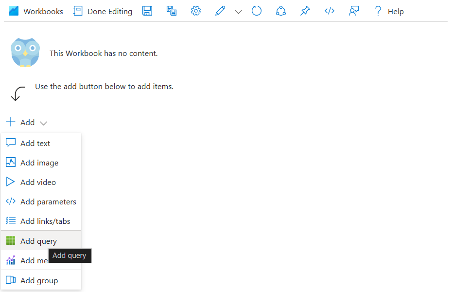

Configure the query to use the lab workspace:

| Setting | Value |
|---|---|
| Data source | Logs (Analytics) |
| Resource type | Log Analytics |
| Workspace | `honeypot-law` |
| Time range | The period containing the lab events |

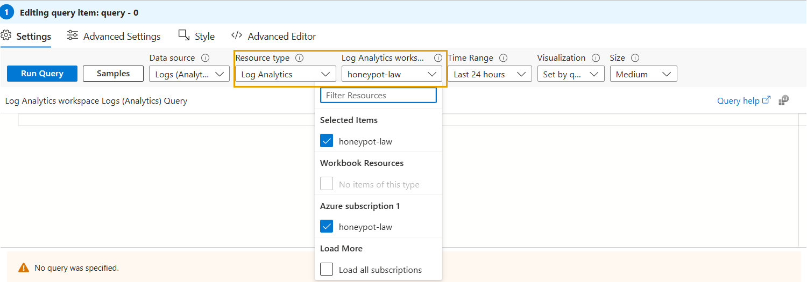

Paste the extraction query from the previous section and click **Run Query**. The results should include the parsed source addresses, usernames, countries, and coordinates.

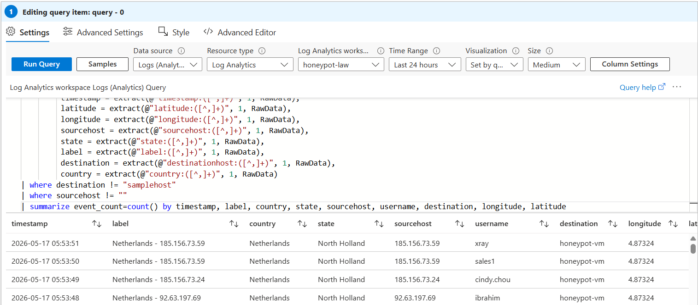

### Configuring the Map

Change **Visualisation** to **Map** and open the map settings. I used the following field mappings:

| Section | Setting | Value |
|---|---|---|
| Layout | Location information | Latitude/Longitude |
| Layout | Latitude | `latitude` |
| Layout | Longitude | `longitude` |
| Layout | Size by | `event_count` |
| Colour | Colouring type | Heatmap |
| Colour | Colour by | `event_count` |
| Colour | Aggregation | Sum of Values |
| Colour | Palette | Green to Red |
| Metric | Label | `label` |
| Metric | Value | `event_count` |

Click **Apply**, save the map settings, and select **Done Editing**. Save the workbook with an appropriate name, subscription, resource group, and location.

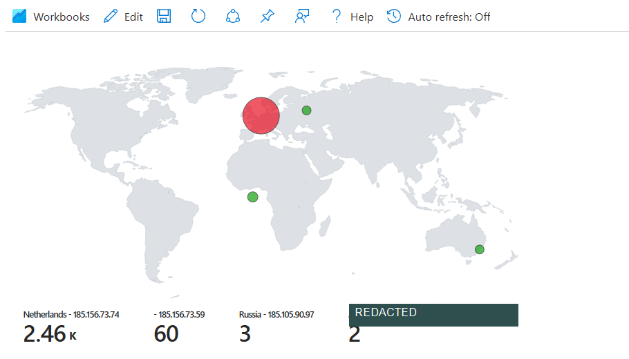

The saved view shows a much larger cluster around the Netherlands than the other displayed locations. One label displays approximately **2.46K** events. This is a later snapshot than the earlier table-count screenshot, so those figures should not be treated as the same collection total.

The map uses the approximate location of an IP address, not a verified physical location or nationality of a person. VPNs, proxies, cloud hosts, and geolocation errors can affect it. The Australia entry includes my own test activity, so it should not automatically be described as hostile traffic. One marker also appears inconsistent with the displayed country labels, which is a reason to validate the coordinates before relying on the map.

The screenshot shows **Auto refresh: Off**. Refresh manually during the observation period, or configure an appropriate refresh interval if needed.

### A More Suitable Query for a Location Summary

For a map focused on total activity per source location, I would use numeric coordinates and group without each individual timestamp and username:

```kusto
FAILED_RDP_WITH_GEO_CL
| extend destination = extract(@"destinationhost:([^,]+)", 1, RawData),
         sourcehost = extract(@"sourcehost:([^,]+)", 1, RawData),
         country = extract(@"country:([^,]+)", 1, RawData),
         state = extract(@"state:([^,]+)", 1, RawData),
         latitude = todouble(extract(@"latitude:([^,]+)", 1, RawData)),
         longitude = todouble(extract(@"longitude:([^,]+)", 1, RawData))
| where destination == "honeypot-vm" and isnotempty(sourcehost)
| where isnotnull(latitude) and isnotnull(longitude)
| where latitude between (-90.0 .. 90.0)
    and longitude between (-180.0 .. 180.0)
| extend label = strcat(country, " - ", sourcehost)
| summarize event_count = count() by label, country, state, sourcehost,
    destination, longitude, latitude
```

This is a revised query for reuse, not the query shown in the original screenshots. Exclude your own test source addresses when you want a view of external activity. The result counts collected records, and cannot guarantee one row per unique authentication attempt if the exporter or collection process duplicates events.

## Results and What I Learned

The lab reached a working pipeline: failed logon events were visible in Windows, the exporter produced enriched text records, AMA reported a heartbeat, the custom table contained data, and the workbook displayed the parsed results on a map.

The main skills I practised were:

- Deploying Azure lab resources and connecting Sentinel to a workspace.
- Investigating Windows Security events.
- Enriching source addresses with geolocation data.
- Configuring AMA, a DCR, a DCE, and a custom log table.
- Troubleshooting collection one stage at a time.
- Extracting fields with KQL and building an Azure Workbook.

The main lesson was that each stage needs its own check. A VM being reachable does not mean an agent is healthy, and a heartbeat does not mean the custom log file is being collected. I also learned to separate seeded examples and my own tests from the external activity being observed.

This was a collection and investigation lab. A next extension would be to add a tested Sentinel detection rule for repeated failed logons, investigate its incidents, and define a response process.

## Cleaning Up the Lab

After the observation period, close the public exposure and stop the exporter. Save any evidence you want to keep before removing the resources.

For a dedicated lab group, open **Resource groups > honeypot-vm_group > Delete resource group**. Review the complete deletion list and confirm that it contains only resources intended for removal.

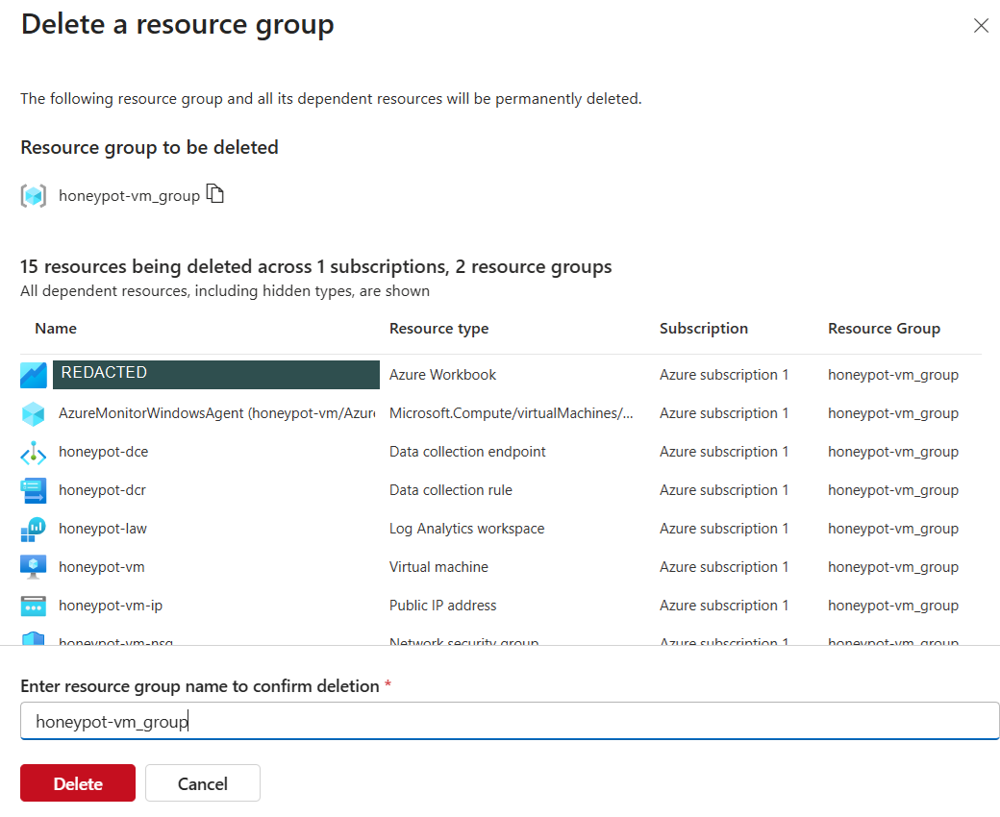

The screenshot records the deletion review, not a completed deletion confirmation. After submitting it, check that the resources have actually been removed and review the subscription for remaining lab resources or charges. Resources outside the selected group may need separate attention.

Revoke or rotate the lab API key if it is no longer needed, and retain only redacted copies of screenshots shared publicly.

## References

- [Microsoft: Collect text logs with Azure Monitor Agent](https://learn.microsoft.com/en-us/azure/azure-monitor/vm/data-collection-log-text)
- [Microsoft: Troubleshoot Azure Monitor Agent on Windows VMs](https://learn.microsoft.com/en-us/azure/azure-monitor/agents/azure-monitor-agent-troubleshoot-windows-vm)
- [Microsoft: Event 4625, an account failed to log on](https://learn.microsoft.com/en-us/windows/security/threat-protection/auditing/event-4625)
- [Microsoft: Azure Workbooks map visualisations](https://learn.microsoft.com/en-us/azure/azure-monitor/visualize/workbooks-map-visualizations)
- [Microsoft: Sentinel in the Defender portal](https://learn.microsoft.com/en-us/azure/sentinel/microsoft-sentinel-defender-portal)
- [ipgeolocation.io API documentation](https://ipgeolocation.io/documentation.html)

